# Classic Coffee Customer Web

Classic Coffee Customer Web — A responsive CodeIgniter 4 web application for customer ordering, featuring product highlights, menu filtering, instant cart management, and dynamic QR Code invoice generation.

## 📺 Demo Video

[](https://www.youtube.com/watch?v=i2iFWwCDxsc)

## Main Features

- **Featured Products & Our Menu:** Clear separation of workflows between archipelago signature coffees and regular menu items.
- **Shopping Cart System:** Interactive, client-side Alpine.js-based shopping cart management.
- **QR Payment Confirmation:** Payment page featuring a server-side API-driven dynamic QR Code, complete with an artistic doodle background.
- **Floating Status Modal:** Instant notifications (success/failure/pending) popping up as floating elements over the QR Code page without redirecting.
- **Contact Us Form:** Direct integration of customer inquiries into the database.

## CRUD Operations Description

On the customer web side (CodeIgniter 4), data operations are divided into client-side local data management (Shopping Cart) and data transmission to the backend server:

1. **Shopping Cart Module (Client-Side Local CRUD):**
   - **Create:** Adds coffee products or snacks to the shopping cart upon clicking the "Buy" / "Add to Cart" button.
   - **Read:** Reads and displays the list of selected shopping items along with price summaries in the cart widget.
   - **Update:** Dynamically updates product quantities (incrementing or decrementing item counts) in the cart.
   - **Delete:** Removes specific items or clears the entire shopping cart.
2. **Checkout & Order Module (Create):**
   - **Create:** Transmits order data (name, phone number, email, item list, and total price) to the Spring Boot backend to be stored as a new transaction.
3. **Contact Us Module (Create):**
   - **Create:** Sends customer contact forms (name, email, subject, and message body) to the database server via backend API.
4. **Menu Catalog Module (Read-Only):**
   - **Read:** Fetches active product catalog data from the backend server for dynamic display to customers.

## Technology

- **Framework:** CodeIgniter 4 (PHP 8.2)
- **Frontend:** Vanilla CSS, Alpine.js, HTML5
- **Database:** MySQL (connected via Spring Boot Server)
- **Web Server:** Apache (Laragon / XAMPP)

## Docker Architecture

This project has been containerized using **Docker** to ensure a consistent development and production environment. The system runs on three main interconnected containers within a single Docker network:

1. **`ta-database-coffeeshop`**: MySQL Container (Port `3307:3306`) storing all application data.
2. **`ta-server-coffeeshop`**: Spring Boot backend container (Port `8083:8083`) connected directly to the database container.
3. **`ta-ci4-web-coffeeshop`**: CodeIgniter 4 frontend container (Port `8080:80`) serving the customer interface and communicating with the backend server.

Using `docker-compose`, the entire environment can be built and run simultaneously without manually configuring Apache, PHP, Java, or MySQL on the host operating system.

## Installation & Running Guide (using Docker)

Here is the complete guide to run and manage the integrated system (Web, Server, and Database) using **Command Prompt (CMD)** via Docker:

### 1. 🚀 Start the Entire System

Open **Command Prompt (CMD)**, then type the following command:

```cmd
cd C:\Dokumen
docker compose up -d --build
```

> **Command Explanation:**
> - `cd C:\Dokumen` $\rightarrow$ Navigate to the Docker Master folder location.
> - `up -d` $\rightarrow$ Start all containers in the background (preventing CMD from locking).
> - `--build` $\rightarrow$ Ensure Docker builds the latest code version of your Web & Server.

### 2. 📊 Check Container Status

To verify if all containers are active and running normally:

```cmd
docker compose ps
```
*(You will see a list of containers: `ta-ci4-web-coffeeshop`, `ta-server-coffeeshop`, and `ta-database-coffeeshop` along with their ports).*

### 3. 📜 View System Logs (Real-time)

To view server activity logs (e.g., when an incoming order transaction occurs):

```cmd
docker compose logs -f
```
*(Press `Ctrl + C` to exit the log view)*.

### 4. 🛑 Shut Down the Entire System

When finished and you wish to stop the containers:

```cmd
cd C:\Dokumen
docker compose down
```


## Testing & Automated Testing

This project is equipped with automated testing scripts built with Selenium WebDriver and pytest to ensure the functionality of all web features (39 test scenarios).

### Testing Prerequisites
1. Ensure Python 3.x is installed on your computer.
2. Install required Python modules via pip:
   ```bash
   pip install selenium pytest pytest-html
   ```
3. Ensure your browser driver (such as ChromeDriver for Google Chrome) matches your browser version and is properly configured.

### Running Automated Tests
1. Run your CodeIgniter 4 web application on port `8081`.
2. Run the following commands through the terminal:
   ```bash
   cd c:/Dokumen/ta-server-coffeeshop/selenium
   pytest test_ci4_web.py -v --html=report_ci4.html --self-contained-html
   ```
3. Automated test results will be recorded in detail, and an interactive report will be generated in the `report_ci4.html` file.

---

## Documentation & Demo

Use the table below to view screenshots, animations, or video documentation of your application.

| Feature | Documentation Preview | Description |
| --- | --- | --- |
| **Homepage** | 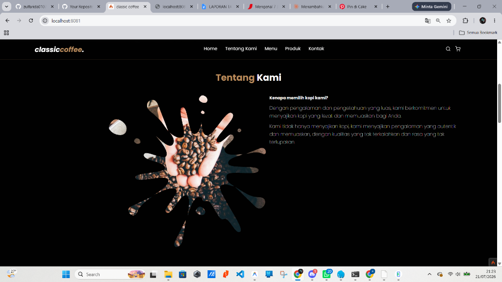 | Main page featuring a modern Classic Coffee hero banner visualization. |
| **About Us** | 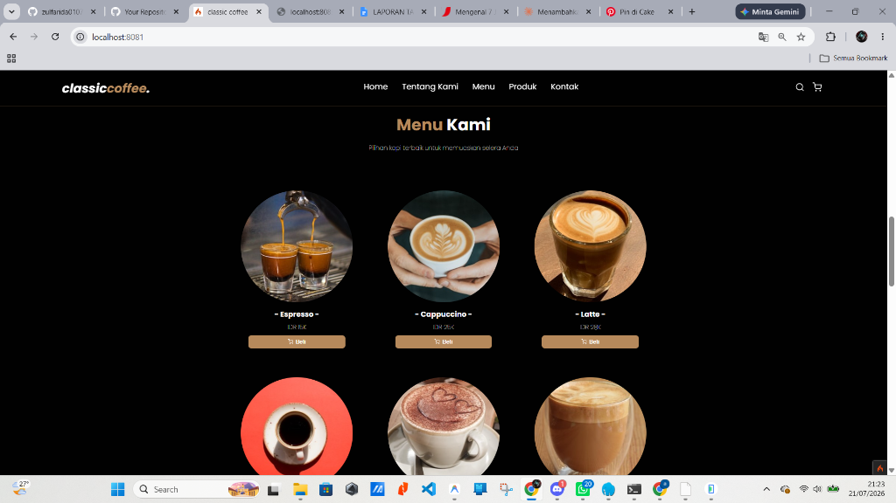 | Profile, dedication, and coffee shop background information page. |
| **Our Menu** | 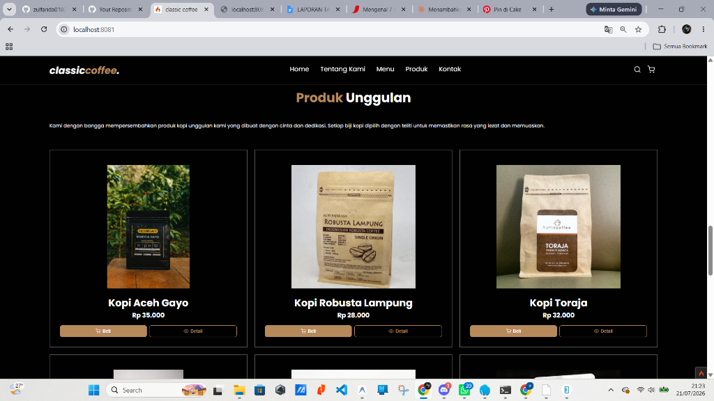 | Coffee, non-coffee, and pastry product list with dynamic filters. |
| **Product Detail & Cart** | 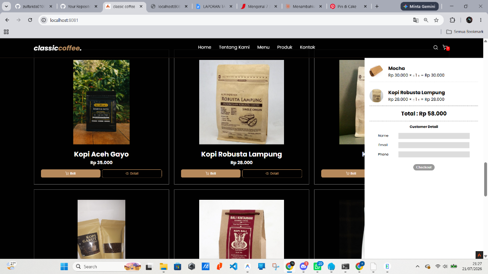 | Menu detail pop-up and customer shopping cart management. |
| **Contact Page** | 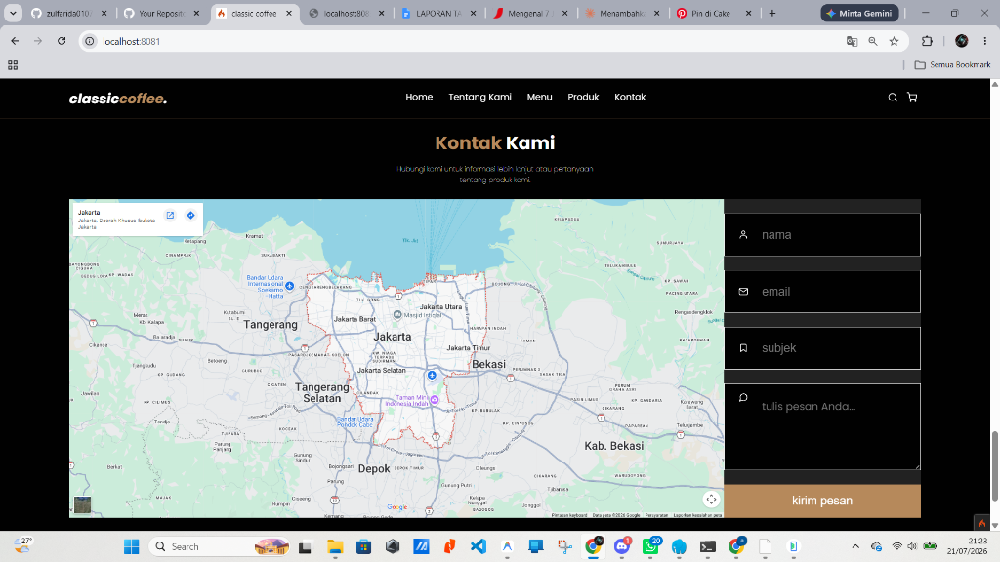 | Customer feedback/suggestion form integrated with Google Maps. |
| **Contact Form Code Snippet** | 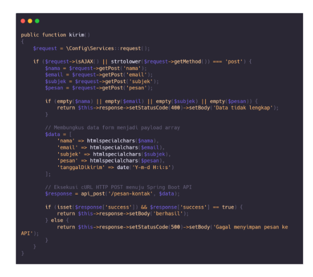 | CI4 PHP Controller code snippet for processing customer feedback submissions to the backend database. |
| **QR Code & Order Detail** | 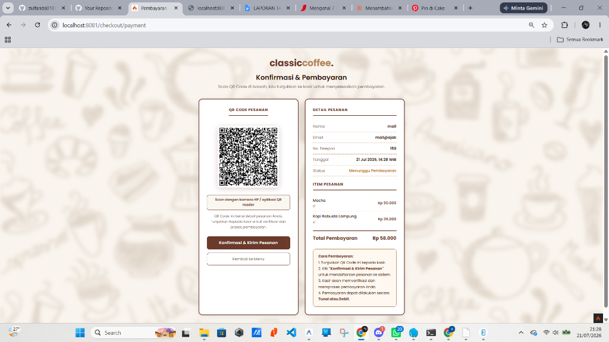 | Payment page displaying order data and QR code. |
| **Transaction Success Modal** | 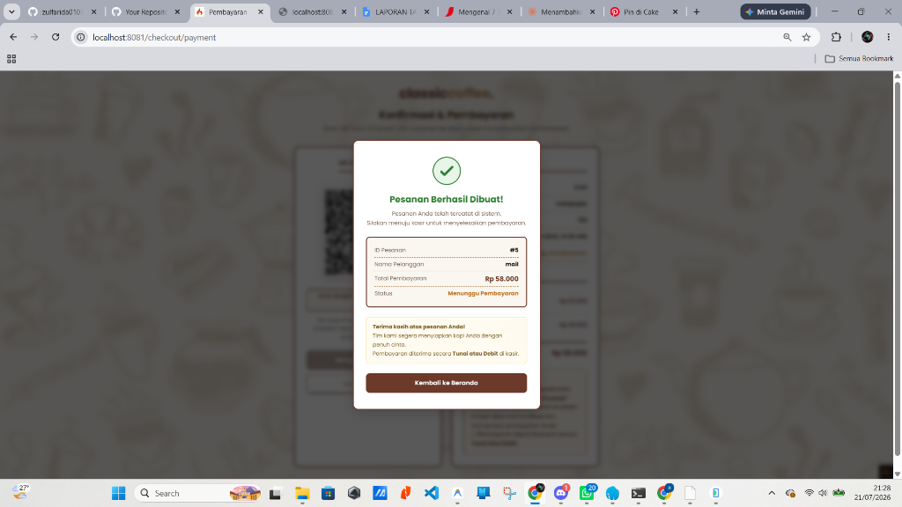 | Floating success modal appearing after the cashier confirms the order. |
| **Transaction Failed Modal** | 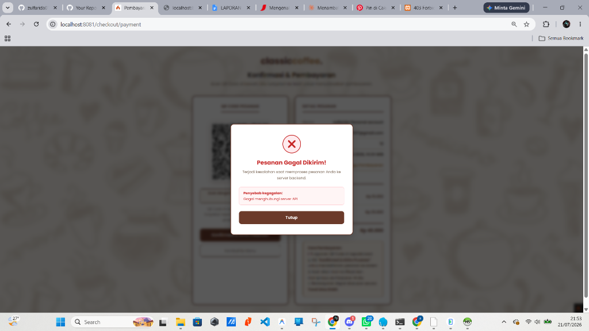 | Red floating "Order Failed to Send!" modal appearing when the API server is unreachable. |
| **Automated Test Report (Selenium)** | 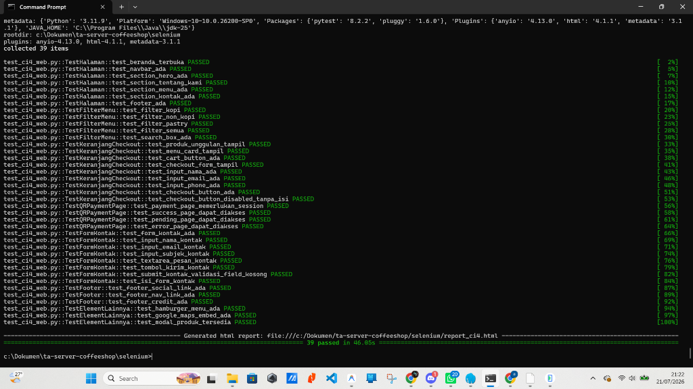 | Automated test execution proof using Selenium showing 39 successful test cases (PASSED). |
| **Docker Build & Up** |  | Image compilation and simultaneous container initialization process using `docker compose up -d --build`. |
| **Container Status (CLI)** |  | Verification of running containers (Web, Server, DB) along with port mappings via `docker compose ps`. |
| **Docker Desktop UI** | 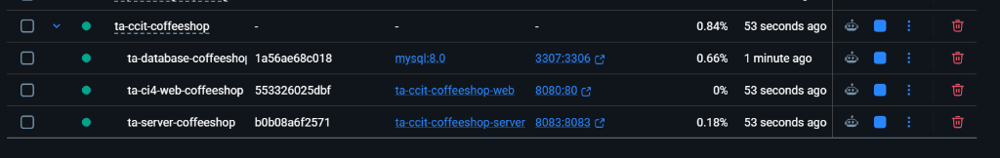 | Visual management interface for containers, resource usage, and logs via Docker Desktop. |
